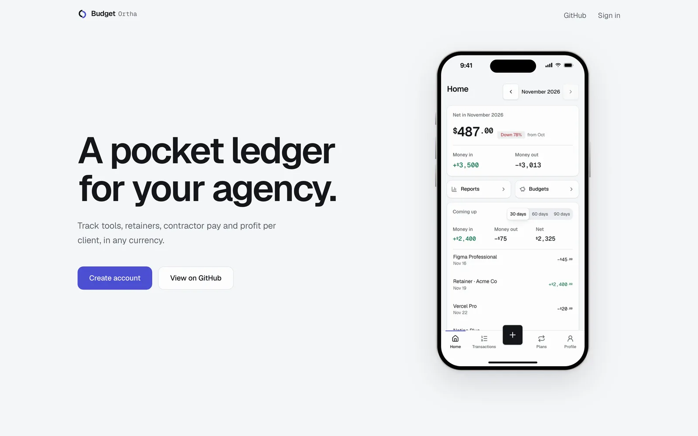
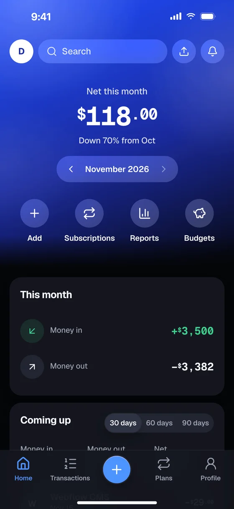
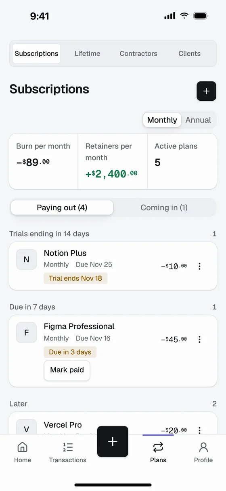
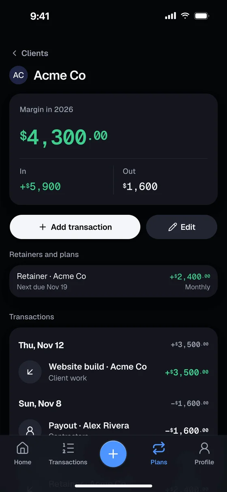
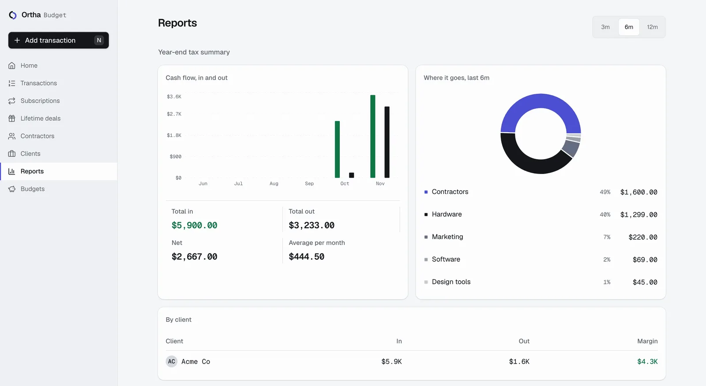

# Ortha Budget

**A pocket ledger for your agency.**
Track tools, retainers, contractor pay and profit per client, in any currency.

[Live app](https://ortha-budget.vercel.app) ·
[Self-host](#self-host) ·
[How the security works](#security) ·
[Report a vulnerability](SECURITY.md)

<picture>
  <source media="(prefers-color-scheme: dark)" srcset="docs/screenshots/welcome-dark.webp" />
  
</picture>

## Why

Agency money is lumpy. Some tools bill monthly, some yearly, and one was a lifetime deal you bought two years ago. Retainers land on different days. Contractors want paying in their own currency. A spreadsheet holds all of that until the day it doesn't.

Ortha Budget keeps each of those as its own kind of entry and answers three questions from your phone: what is due, what do you owe, and which clients make you money.

## Screens

<table>
  <tr>
    <td width="33%"></td>
    <td width="33%"></td>
    <td width="33%"></td>
  </tr>
  <tr>
    <td align="center">Home</td>
    <td align="center">Subscriptions</td>
    <td align="center">Profit per client</td>
  </tr>
</table>

## What it does

| | |
|---|---|
| **Subscriptions and retainers** | Monthly, quarterly, yearly or weekly plans with the next due date. One tap marks a charge paid, logs it and moves the date forward. Toggle between monthly and yearly cost. |
| **Renewal reminders** | A private calendar feed (`.ics`) puts renewals, trial end dates and "cancel by" dates into Apple or Google Calendar. Your calendar sends the alerts. |
| **Trials, cancel-by and price changes** | Trials ending soon and plans you meant to cancel sit at the top. A price increase gets flagged with the date and the percentage. |
| **Lifetime deals** | Each deal records what it replaces per month and shows how many months until it has paid for itself. |
| **Contractors** | People, rates and payout history in their own currency, with the amount in your base currency next to it. |
| **Profit per client** | Tag any entry or retainer with a client. The client page shows income, costs and margin. |
| **Any currency** | Every entry keeps its own currency and rate. Totals show in your base currency (USD, EUR, GBP, BDT and others), and changing it converts everything in one step. |
| **Forecast and runway** | Expected money in and out for the next 30, 60 or 90 days. Add your cash balance to see runway in months. |
| **Tax set-aside** | Set a percentage and the dashboard shows how much of this month's income to keep aside. |
| **Budgets** | A monthly limit per category, with a warning at 85% and a clear "over by" when you pass it. |
| **Receipts** | Attach a photo or PDF to any entry. You can take the photo straight from your phone camera. Files stay private to your account. |
| **Year-end report** | Income, costs by category and client, contractor payouts and tax set-aside for a year. Print it to PDF or download it as CSV. |
| **Import and export** | Import a bank or spreadsheet CSV with column mapping, or export everything as CSV. |
| **Fast on desktop** | ⌘K command palette, `n` for a new entry, `g` then `h/t/s/r` to jump between pages. |

## Self-host

You need a Supabase project and somewhere to run Next.js (Vercel works out of the box).

1. **Database.** In Supabase, open **SQL Editor** and run [`supabase/schema.sql`](supabase/schema.sql). It creates the tables, row-level security, the private receipts bucket and the functions.
2. **Auth.** In **Authentication → Sign In / Providers**, keep Email enabled. If you have SMTP set up, turn on "Confirm email". Supabase's built-in mailer only reaches project members.
3. **Env.** `cp .env.local.example .env.local` and fill in `NEXT_PUBLIC_SUPABASE_URL`, `NEXT_PUBLIC_SUPABASE_ANON_KEY` (the publishable key) and `NEXT_PUBLIC_APP_TZ` (your timezone, e.g. `Europe/London`).
4. **Run.** `npm install && npm run dev`, then open http://localhost:3000 and create an account. "Load sample data" on the empty dashboard fills it in so you can look around.

## Security

- **Your rows are yours.** Every table has Postgres row-level security: a row is readable and writable only when its `user_id` matches the signed-in user's id. The anonymous role has no table access at all.
- **No admin key in the app.** The server talks to Supabase as the signed-in user. There is no service-role key anywhere, so a bug in app code can't reach another account's data.
- **Checked input.** Every server action re-validates its input (types, enums, lengths, dates, ids) before it reaches the database. Composite foreign keys stop an entry from pointing at someone else's client, contractor or plan.
- **Private files.** Receipts live in a private bucket under a folder named after your user id. Storage policies reject anything outside it, and files are only ever served through 60-second signed links.
- **The one public endpoint** is the calendar feed. It answers only to a random 43-character token you can reset at any time, and it returns the same empty calendar for a wrong token as for an empty account.
- **Safe exports.** CSV cells are escaped, and spreadsheet formula injection is neutralised.
- **Headers.** HSTS, `X-Frame-Options: DENY`, `frame-ancestors 'none'`, nosniff, a strict referrer policy and a locked-down permissions policy.

Found something? Please report it privately: see [SECURITY.md](SECURITY.md).

## How it's built

| | |
|---|---|
| App | Next.js 16 (App Router, Server Actions), React 19, TypeScript |
| UI | shadcn/ui on Base UI, Tailwind CSS v4, Geist Sans and Geist Mono, CSS-only motion that respects reduced-motion settings |
| Data and auth | Supabase Postgres, Supabase Auth (email and password), Storage, row-level security |
| Tests | Playwright end-to-end tests on mobile and desktop (`npm run test:e2e`), plus small runnable checks for the forecast, calendar feed and CSV parser |

The data model lives in [`supabase/schema.sql`](supabase/schema.sql), and design notes are in [`docs/`](docs). They include the Mobbin references behind each screen and the motion spec.

## Roadmap

- Email reminders, as an alternative to the calendar feed
- Shared read-only access for an accountant
- Bank CSV presets for common banks

## License

[MIT](LICENSE)
